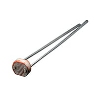
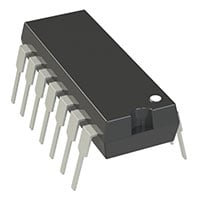
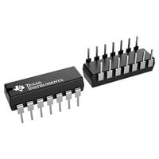
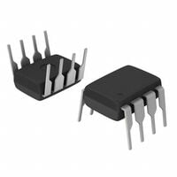

# Component Selection: Light Sensing Subsystem

This document identifies, compares, and contrasts multiple off-the-shelf and custom solutions for every major active component in the Light Sensing Subsystem.

---

## Major Component Selections

### Light Sensor / Photoresistor
- **Subsystem:** Light Sensing Subsystem
- **Description:** A variable resistor whose resistance decreases with increasing incident light intensity, used to detect ambient light levels.

**Option 1:** [Advanced Photonix PDV-P8103 Photoresistor](https://www.digikey.com/en/products/detail/advanced-photonix/PDV-P8103/480610?gclsrc=aw.ds&gad_source=1&gad_campaignid=20232005509&gclid=CjwKCAjw88HWBhA3EiwAo2Zd6ItJudJQgGAMYT0UdEfhO8QxFR5CcLx-1gv10VwK_xdwT0Irrl9zuBoCCXIQAvD_BwE)  
.jpg)
- **Unit Cost:** $0.72
- **Pros:**
  * Industry-standard component with well-documented spectral response matching human eye adaptation (~520 nm peak)
  * Reliable 16–33 kΩ resistance range at 10 lux for clear voltage divider scaling
  * Simple passive two-terminal through-hole interface requiring minimal board space
- **Cons:**
  * Contains cadmium sulfide (CdS), which is subject to environmental regulatory restrictions in certain regions
  * Slower response time compared to semiconductor photodiodes
  * Performance varies noticeably across operating temperature ranges

**Option 2:** [Adafruit Industries LLC Photoresistor (161)](https://www.digikey.com/en/products/detail/adafruit-industries-llc/161/7244927?gclsrc=aw.ds&gad_source=4&gad_campaignid=20232005509&gclid=CjwKCAjw88HWBhA3EiwAo2Zd6A3haKnLQ2WzPscs47utOvQ20RPyVMHKu1Gbs-S90HJDtFfdsrHo3hoCyNYQAvD_BwE)

- **Unit Cost:** $0.95
- **Pros:**
  * Easily accessible hobbyist and prototyping component with broad community documentation
  * Standard through-hole leads fit standard breadboards and perfboards seamlessly
  * Cost-effective solution for basic light-level detection
- **Cons:**
  * Lacks detailed, rigorous industrial datasheet parametric curves for precise engineering calculations
  * Part-to-part manufacturing tolerances can be wider than industrial-grade components

**Option 3:** [Advanced Photonix NSL-19M51 Photoresistor](https://www.digikey.com/en/products/detail/advanced-photonix/NSL-19M51/5039794?gclsrc=aw.ds&gad_source=4&gad_campaignid=20232005509&gclid=CjwKCAjw88HWBhA3EiwAo2Zd6GKBTk-YHDayWF8TEzknnWdCNLg3ZWkpF4lIr4LGKpLHJ30Gbes0qRoCjgsQAvD_BwE)  
.jpg)
- **Unit Cost:** $1.05
- **Pros:**
  * Tight resistance tolerance band for more predictable circuit response
  * Optimized peak spectral response closely mimicking human eye perception
  * High-reliability hermetic or robust package construction suitable for semi-industrial environments
- **Cons:**
  * Higher unit cost compared to standard commercial CdS cells
  * Slower dark-to-light transition times under low illumination levels

**Choice:** Option 1: Advanced Photonix PDV-P8103 Photoresistor  
**Rationale:** We went with this photoresistor because it's widely used, easy to find data on, and gives us a very reliable resistance change when room lighting shifts. Plus, its through-hole leads make it super easy to mount right up against our enclosure window without needing any adapters.

---

### Signal Conditioning / Operational Amplifier
- **Subsystem:** Light Sensing Subsystem
- **Description:** Active multi-channel integrated circuit used to buffer, scale, and condition the analog voltage signal from the photoresistor divider before routing it to the microcontroller ADC.

**Option 1:** [Microchip Technology MCP6004-I/P Quad Op-Amp](https://www.digikey.com/en/products/detail/microchip-technology/MCP6004-I-P/523060?gclsrc=aw.ds&gad_source=1&gad_campaignid=20790518593&gclid=CjwKCAjw88HWBhA3EiwAo2Zd6FaBLTIoZlL08YNlASY-dnVOxjivM6t0XIXYmlYQm0FLJhkiRFNeFxoCJRIQAvD_BwE)  

- **Unit Cost:** $0.60
- **Pros:**
  * Quad packaging provides four independent amplifiers in a single 14-pin DIP package, matching multi-channel project needs
  * Rail-to-rail input and output voltage capability maximizes ADC dynamic range
  * Extremely low quiescent supply current (~100 µA per channel) ideal for efficient power budgets
- **Cons:**
  * Modest 1 MHz Gain Bandwidth Product limits high-frequency filtering applications
  * Higher input offset voltage (4.5 mV max) compared to precision zero-drift amplifiers

**Option 2:** [Texas Instruments LM324AN/NOPB Quad Operational Amplifier](https://www.digikey.com/en/products/detail/texas-instruments/LM324AN-NOPB/4733935?gclsrc=aw.ds&gad_source=4&gad_campaignid=20228387720&gclid=CjwKCAjw88HWBhA3EiwAo2Zd6OxryJVN4nKf-lCkC1aVKXZiIfELwSPW_sR4lHUh46O6irp-H2pELhoCIbIQAvD_BwE)  

- **Unit Cost:** $1.18
- **Pros:**
  * Industry classic, highly robust, and widely second-sourced across manufacturers
  * Operates on a wide single-supply voltage range with low unit cost
  * Readily available through-hole PDIP package for straightforward prototyping
- **Cons:**
  * Outputs do not comfortably reach ground ($V_{ss}$) without a pull-down resistor on single-supply setups
  * Higher input bias currents can introduce loading errors on high-impedance resistive sensors

**Option 3:** [Texas Instruments LM2904N/NOPB Dual Operational Amplifier](https://www.digikey.com/en/products/detail/texas-instruments/LM2904N-NOPB/9503?gclsrc=aw.ds&gad_source=4&gad_campaignid=20228387720&gclid=CjwKCAjw88HWBhA3EiwAo2Zd6PNaR_L9dUJDYL6c3gw-JPnZcgQEP2BATJxfeRAvDtghp4Jzk9s9jBoCKjwQAvD_BwE)  

- **Unit Cost:** $1.53
- **Pros:**
  * Proven automotive/industrial grade dual op-amp with robust temperature stability
  * Low input bias current and low quiescent power consumption
  * Standard 8-pin DIP package is compact and easy to solder
- **Cons:**
  * Only contains two operational amplifiers per package, requiring multiple ICs if extra channels are needed
  * Slower slew rate compared to modern CMOS operational amplifiers

**Choice:** Option 1: Microchip Technology MCP6004-I/P Quad Op-Amp  
**Rationale:** The MCP6004 is great because it has rail-to-rail inputs and outputs, meaning our signal can go all the way from 0V to 5V without getting cut off or clipped by the chip. Having four amps in one package also gives us extra room to work with if we need to expand our circuit later.

---

### Voltage Regulator
- **Subsystem:** Power Distribution / Light Sensing Subsystem
- **Description:** Linear voltage regulator used to step down an external DC input voltage to a stable +5V rail for system logic and active sensors.

**Option 1:** [STMicroelectronics L7805CV Linear Regulator](https://www.digikey.com/en/products/detail/stmicroelectronics/L7805CV/585964?gclsrc=aw.ds&gad_source=4&gad_campaignid=24216345527&gclid=CjwKCAjw88HWBhA3EiwAo2Zd6CxCh2O9be1WQWI78UesoRwUkcHCLdEhWNnG7OsbKwciV7ROlTCfPBoCBhcQAvD_BwE)  

- **Unit Cost:** $1.08
- **Pros:**
  * Built-in internal thermal overload and short-circuit current limiting protections
  * Industry-standard TO-220 package allows easy attachment to a heatsink if dissipation increases
  * Requires very few external support components (simple input/output bypass capacitors)
- **Cons:**
  * Low power efficiency when dropping high input voltages down to 5V (linear voltage drop is lost as heat)
  * Higher dropout voltage requires at least 7V–7.5V input to guarantee solid 5V regulation

**Option 2:** [Fairchild Semiconductor LM7805CT Linear Regulator](https://www.digikey.com/en/products/detail/fairchild-semiconductor/LM7805CT/12600247?gclsrc=aw.ds&gad_source=4&gad_campaignid=20228387720&gclid=CjwKCAjw88HWBhA3EiwAo2Zd6McY28ejmCJkb6UukR0h0GEDCj0qNVoPqMKogwqu5gk92IukwZcxpRoCyNIQAvD_BwE)  
.jpg)
- **Unit Cost:** $1.74
- **Pros:**
  * Classic 1.5A positive voltage regulator design with robust transient response
  * Standard pinout compatible with universal TO-220 layouts
  * Well-established thermal and electrical safety characteristics
- **Cons:**
  * Stock availability can fluctuate depending on manufacturer lot allocations
  * Standard linear thermal dissipation constraints apply under heavy load differences

**Option 3:** [UMW L7805CV Linear Regulator](https://www.digikey.com/en/products/detail/umw/L7805CV/17635308?gclsrc=aw.ds&gad_source=4&gad_campaignid=21136823955&gclid=CjwKCAjw88HWBhA3EiwAo2Zd6DBtzZL1cR3kaDQNRy3iu1tnKz8BVTbi_Mep4_b3YuI4tf5wW3_iKRoCOXQQAvD_BwE)  

- **Unit Cost:** $1.74
- **Pros:**
  * Highly economical pricing for budget-conscious project builds
  * Standard TO-220 packaging for easy mounting and prototyping
  * Provides stable fixed 5V output for standard logic and sensor rails
- **Cons:**
  * Alternative second-source brand with less historical pedigree than tier-1 manufacturers like STMicroelectronics
  * Maximum output current is rated slightly lower or subject to variance compared to classic 1.5A variants

**Choice:** Option 1: STMicroelectronics L7805CV Linear Regulator  
**Rationale:** We chose the STMicro regulator because it's a dependable, standard part that gives us a clean 5V output without adding switching noise to our sensitive analog sensor lines. The TO-220 package also makes it simple to mount and handle during testing.

---

## Pin Table

| Pin Number / Designator | Subsystem / Component | Signal Name / Type | Description |
| :--- | :--- | :--- | :--- |
| **RA0 / AN0** | Microcontroller (PIC18F57Q43) | Analog Input | Receives conditioned 0–5V analog signal from the non-inverting op-amp stage |
| **RC2** | Microcontroller (PIC18F57Q43) | Digital Output (UART1 TX) | Transmits serial data through Connector 1 |
| **RC3** | Microcontroller (PIC18F57Q43) | Digital Input (UART1 RX) | Receives external serial commands through Connector 1 |
| **Connector Pin 1** | External Interface | Digital / Serial | UART RX connection line |
| **Connector Pin 2** | External Interface | Digital / Serial | UART TX connection line |
| **Connector Pin 6** | External Interface | Analog | Raw analog signal test point / breakout |
| **Connector Pin 8** | External Interface | Ground (GND) | System common ground return |
