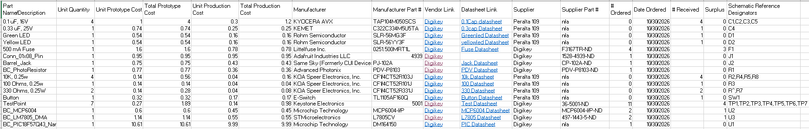

# Bill of Materials (BOM)

This page presents the Bill of Materials for my subsystem design, detailing the components required for schematic design, prototyping, and PCB assembly.

---

## BOM Overview

---

## File Downloads

* **Excel Workbook:** [Download BOMEGR304.xlsx](BOMEGR304.xlsx)
