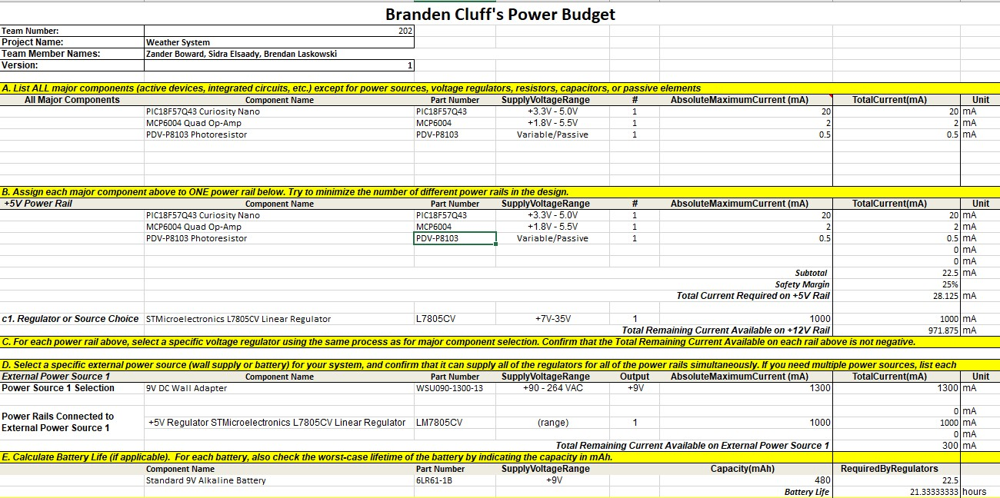

# Power Budget Overview & Summary

## What I Did
I created a complete power budget for my Light Sensing Subsystem by breaking down every active component and tracking how power flows through the system:
1. **Listed Active Components:** I identified my microcontroller, op-amp, and photoresistor as the core power consumers, recording their exact maximum current draws from my design.
2. **Calculated Rail Requirements:** I consolidated everything onto a single +5V power rail, added a 25% safety buffer, and calculated a total required active current of **28.125 mA**.
3. **Selected Voltage Regulation & Power Source:** I chose the L7805CV linear regulator to step down a 9V DC wall adapter (`WSU090-1300-13`), ensuring clean, low-ripple analog power with plenty of headroom.
4. **Projected Battery Life:** I calculated the estimated continuous runtime (around **21.33 hours** using a 480 mAh 9V battery) should I ever choose to run the circuit portably during testing.

## Why I Did a Power Budget
A power budget is a critical step in engineering design for several reasons:
* **Prevents Component Failure:** It guarantees that my power supplies, regulators, and wall adapters can deliver enough current without overheating or dropping voltage.
* **Ensures Signal Integrity:** By mapping out current draws and using a clean linear regulator, I protect sensitive analog sensors and amplifiers from electrical noise that could ruin sensor readings.
* **Verifies Feasibility:** It proves mathematically that my circuit design is safe, reliable, and ready for both benchtop laboratory testing and final enclosure assembly.

---
{style width:"350" height:"300;"}

# Conclusions from the Prepared Power Budget

## Summary of Findings
After completing and analyzing the power budget for the Light Sensing Subsystem, several key conclusions can be drawn:

* **Sufficient Power Delivery:** The system requires a total active current of 22.5 mA, which increases to **28.125 mA** after applying a standard 25% engineering safety margin. The selected 9V DC wall adapter (WSU090-1300-13) provides a 1300 mA capacity, leaving 300 mA of remaining headroom on the power source and ensuring the supply never experiences thermal overload or voltage sag.
* **Stable and Clean Regulation:** By stepping down the incoming 9V supply using an L7805CV linear regulator onto a single regulated **+5.0V power rail**, my sensitive analog components (like the MCP6004 op-amp and photoresistor divider) receive steady DC power free from unwanted noise.
* **Feasible Portable Runtime:** While intended primarily for desktop laboratory operation, calculations confirm that the circuit can be powered via a standard 9V alkaline battery (6LR61-1B, 480 mAh capacity) for roughly **21.33 hours** of continuous runtime if field testing is ever required.

## Final Design Verdict
My power distribution architecture is clean, efficient, and built with reliable, standard components. It avoids unnecessary circuit complexity while guaranteeing safe, stable performance for both benchtop testing and final enclosure integration.
## Resouces

The power budget as a PDF download is available [*here*](PowerBudgetBS.pdf), and a Microsoft Excel Sheet [*here*](PowerBudgetBS.xlsx).
